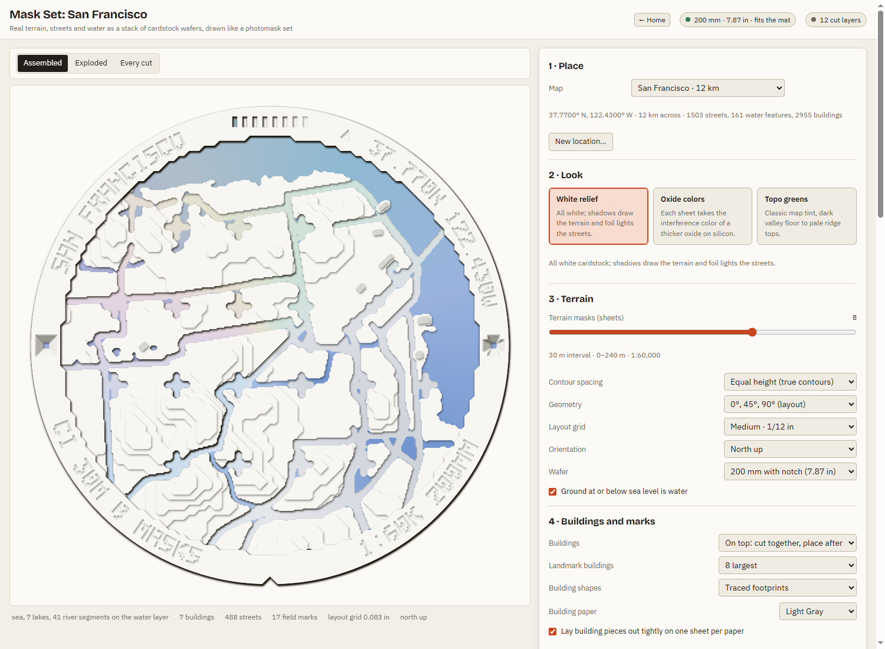
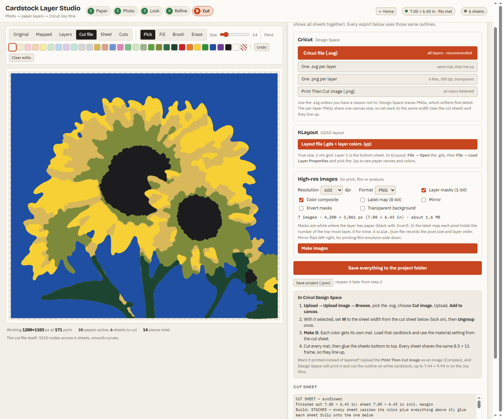

# PaperStrata

**Turn a photo or any place on Earth into stacked layers you can cut, lay out or print.**
Works with Cricut®, laser cutters, KLayout, and any tool that reads SVG, PNG or TIFF.

- **From a photo:** pick your paper colors and how many sheets; PaperStrata finds the color regions, drops pieces too small to cut, and stacks them.
- **From a map:** paste coordinates from Google Maps and choose how wide an area to show; PaperStrata downloads real elevation, streets and water and turns the terrain into one sheet per contour.

### Works with

| Tool | What you use | Status |
|---|---|---|
| Cricut Design Space | One SVG with every layer, or one SVG/PNG per layer, plus a Print Then Cut image | The main target; sized for the Cricut Joy Xtra mat |
| Other cutting machines (Silhouette, Brother ScanNCut) | The per-layer SVGs | Should work in any software that imports SVG (Silhouette needs Designer Edition or higher for SVG); not tested |
| Laser cutters (LightBurn, Glowforge, xTool) | The per-layer SVGs, one file per sheet of wood, acrylic or paper | Standard SVG; stacked topo maps are a classic laser project; not tested |
| KLayout and other GDSII tools | `.gds` at true size, one layer per sheet, plus a `.lyp` color file | Tested: the test suite reads every file back with KLayout |
| Printing, film photomasks, screen-print separations | 1-bit layer masks up to 4800 dpi, mirror and invert | PNG and TIFF with the real dpi recorded |
| ImageJ/Fiji, MATLAB, Python, GIS | Layer masks, a label map (pixel value = layer number) and `scale.json` with the pixel size | Tested: every image is decoded independently in the tests |

Everything runs on your own computer. The app opens in your web browser, but nothing is uploaded anywhere. Only map downloads go online (to fetch elevation, streets and water for the place you choose).



---

## 1. Start the app

### Windows

1. Go to the [**Releases**](../../releases) page and download **PaperStrata-windows.zip**.
2. Unzip it (right-click → **Extract All**), then double-click **PaperStrata.exe**.
3. If Windows shows *"Windows protected your PC"*, click **More info**, then **Run anyway**. (The program isn't signed with a paid certificate, so Windows doesn't recognise it yet.)
4. A black window opens and your browser shows the app. **Keep the black window open while you work; close it to quit.**

### Mac (Apple silicon: M1 and newer)

1. Download **PaperStrata-macos-apple-silicon.zip** from [**Releases**](../../releases) and double-click it to unzip.
2. **Right-click** (or Control-click) **PaperStrata** and choose **Open**, then **Open** again.
   If macOS still refuses, open **System Settings → Privacy & Security**, scroll down, and click **Open Anyway**.
3. A Terminal window opens and your browser shows the app. **Keep the Terminal window open while you work; close it to quit.**

On an Intel Mac, use the "From the source code" steps below.

### From the source code (Windows, Mac or Linux)

You need [Python](https://www.python.org/downloads/) 3.9 or newer. Nothing else gets installed.

1. On this page click **Code → Download ZIP**, and unzip it (or `git clone` the repository).
2. Start it:
   - **Windows:** double-click `start.bat`
   - **Mac:** double-click `start.command` (the first time, right-click → **Open**)
   - **Linux:** run `./start.sh` in a terminal
3. Your browser opens the app. Keep the window that started it open; close it to quit.

If the browser doesn't open, go to **http://127.0.0.1:8765** yourself.

---

## 2. Make something

### From a photo



1. **Paper.** Pick the cardstock you have. Four Hello Hobby packs are preloaded; switch off colors you don't own, or use **Sample from photo** to measure your real sheets.
2. **Photo.** Upload a picture (or drop or paste it), or click one of the three example photos. Set the finished width.
3. **Look.** Choose *True to color*, *High contrast* or *Poster bands*, and how many sheets.
4. **Refine.** Reassign colors, reorder sheets, and touch up regions with Fill or Brush.
5. **Cut.** Export (see section 3).

### From a map

1. In **1 · Place**, pick one of the examples (**San Francisco**, **Rome**, **Sydney Harbour**) or click **New location…**
2. For a new location:
   - **Coordinates:** in Google Maps, right-click the spot you want and click the numbers at the top of the menu; they're copied. Paste them into the box. A Google Maps link, or a format like `37°55'24.6"N 122°35'47.4"W`, also works. A green tick confirms the app understood them, with a link to check the spot on Google Maps.
   - **Field of view:** how wide an area the wafer shows, in **km** or **mi** (use the toggle). Between 0.2 and 30 km. Smaller areas show more streets and buildings.
   - Click **Download map data**. This takes from a few seconds to a couple of minutes. The map is saved, so next time it opens instantly.
3. Adjust the look, number of terrain sheets, streets, water and buildings. Click a building on the preview to add or remove it.
4. Export (see section 3).

The terrain comes out as one sheet per contour; streets are cut through every sheet down to a foil layer, and water down to a blue layer. Ground at or below sea level is treated as water.

---

## 3. Export

The last step of both tools has the same three cards. With the app running, files are saved to
**Documents › PaperStrata › output › *your project*** (click **Open folder**). **Save everything** writes all of it at once.

| Card | What you get | Use it for |
|---|---|---|
| **Cricut** | One `.svg` with every layer (recommended); one `.svg` or `.png` per layer; a flattened Print Then Cut `.png`; a cut sheet | Cricut Design Space |
| **KLayout** | A `.gds` layout at true size (layer 1 = bottom sheet), and a `.lyp` file with layer names and paper colors | KLayout, or any GDSII tool |
| **High-res images** | Per-layer 1-bit masks, a color composite, a label map (pixel value = layer number), plus `scale.json` with the pixel size and layer order. Choose 300–4800 dpi, PNG or TIFF, mirror, invert | Printing, film masks, laser engravers, ImageJ/Fiji, MATLAB, Python |

### In Cricut Design Space

1. **Upload → Upload image → Browse**, pick the `.svg`, choose **Cut image**, then **Add to canvas**.
2. Check the width matches the cut sheet (keep the lock on). Map wafers import at their true size (7.87 in for 200 mm); don't resize them.
3. **Ungroup** once, then **Make It → On Mat**. Each color gets its own mat; choose a cardstock setting for each.
4. Glue the sheets bottom to top.

*Why the size limit?* A Cricut Joy Xtra cuts up to 8.2 × 11.7 in on a machine mat. The app warns you when something is bigger.

### In KLayout

1. **File → Open** the `.gds`.
2. **File → Load Layer Properties** and pick the `.lyp` next to it, to see each sheet's name and paper color.

Units are real: 1 database unit = 1 nm. Holes inside a layer are joined to their outline by a zero-width cut, because GDSII polygons can't have holes; KLayout merges them back seamlessly.

### In other image tools

Every image records its resolution (dpi), so ImageJ/Fiji (**Image → Properties**), Photoshop and GIMP show the true size. `scale.json` lists the inches and micrometres per pixel and what each layer is. Masks are white where a layer has paper (black with **Invert**).

---

## Troubleshooting

- **"The map tool downloads and reads map data through the app"**: you opened an `.html` file directly. Start the app (section 1) and use the page it opens.
- **A map download fails or is slow**: the free OpenStreetMap service is sometimes busy. The app retries and tries a second server; wait a minute and try again, or pick a smaller field of view.
- **Port already in use**: the app picks another port and tells you which in its window.
- **Very large image exports** (thousands of dpi on a big design) need a lot of memory and time. The export card shows the image size before you start.

---

## For developers

```
paperstrata/   the local app (Python standard library only): web server, coordinate parser, map downloader
web/           the browser app: photo.html, map.html, js/engine.js (image to layers), js/export.js (GDS, PNG, TIFF writers), js/export-ui.js
sites/         example map data (regenerate with python -m paperstrata.sitefetch, see docs/site-format.md)
tests/         python -m unittest discover -s tests/py -v   (JS checks run in headless Edge/Chrome; pip install klayout for the GDS checks)
packaging/     PyInstaller spec; .github/workflows/build.yml builds the Windows and Mac programs when a v* tag is pushed
```

- Run from source: `python -m paperstrata` (`--port`, `--no-browser`, `--verbose`).
- Fetch a map from the command line: `python -m paperstrata.sitefetch --name "Rome" --coords "41.8925, 12.4853" --diameter 5 --unit km --out sites/rome.json`
- Map data format: [docs/site-format.md](docs/site-format.md).

## Credits and licenses

- Code: MIT License (see [LICENSE](LICENSE)).
- Map data © [OpenStreetMap contributors](https://www.openstreetmap.org/copyright), ODbL. Maps you make from it must credit OpenStreetMap; the exported placard text includes the credit.
- Elevation: [AWS Terrain Tiles](https://registry.opendata.aws/terrain-tiles/) (Mapzen/Tilezen), built from USGS 3DEP, SRTM, GMTED2010, ETOPO1 and other sources; see their [attribution](https://github.com/tilezen/joerd/blob/master/docs/attribution.md).
- Example photos: public domain or CC0; see [web/examples/photos/CREDITS.md](web/examples/photos/CREDITS.md).
- Fonts: IBM Plex and Bricolage Grotesque, SIL Open Font License (web/fonts/).
- JSZip 3.10.1, MIT license (web/vendor/).
- Paper colors are approximations; Hello Hobby doesn't publish color values.
- Cricut, Design Space and Cricut Joy Xtra are trademarks of Cricut, Inc. Silhouette, Brother, ScanNCut, LightBurn, Glowforge, xTool and Hello Hobby are trademarks of their owners. PaperStrata is an independent hobby project and isn't affiliated with or endorsed by any of them; the names only say which tools it works with.
